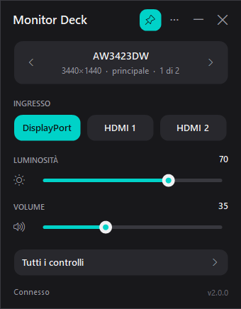
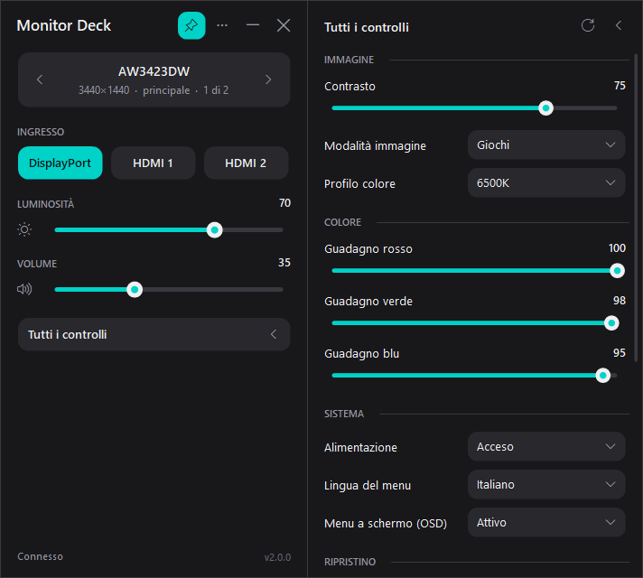

# Monitor Deck

Piccola app per Windows che comanda i monitor via **DDC/CI**: cambio ingresso, luminosità, volume e tutti gli altri comandi che il monitor mette a disposizione, senza usare i tasti dietro lo schermo.

<p align="center">
  
  &nbsp;
  
</p>

## Funzioni

- **Finestra compatta** con i comandi principali: ingresso, luminosità, contrasto e volume (con muto).
- **Tutti i monitor collegati**, uno alla volta: frecce, clic sul nome o `Ctrl+Tab`.
- **Tutti i controlli**: un pulsante allarga la finestra e mostra ogni comando supportato dal monitor (modalità immagine, profili colore, RGB, nitidezza, lingua del menu, alimentazione, ripristini, firmware…).
- **Icona nell'area di notifica**: clic per aprire o chiudere la finestra, tasto destro per il menu rapido.
- **Scorciatoie globali** configurabili, con indicatore a schermo.
- **Aggiornamenti automatici** dalle release di GitHub, con le novità di ogni versione.
- Un solo file `.exe` di circa 120 KB, senza installazione: usa il .NET Framework già presente in Windows 10 e 11.

## Installazione

1. Scarica `MonitorDeck.exe` dall'[ultima release](https://github.com/LoLler111/MonitorDeck/releases/latest).
2. Mettilo in una cartella dove hai i permessi di scrittura (es. `Documenti\MonitorDeck`): lì l'app salva `MonitorDeck.ini` e si aggiorna da sola.
3. Avvialo. Per farlo partire con Windows: menu `⋯` → **Avvia con Windows** (parte ridotto nell'area di notifica).

Sul monitor deve essere attivo **DDC/CI** (di solito nel menu del monitor, sotto "Altro" o "Sistema").

## Uso

| Dove | Cosa fa |
|---|---|
| Frecce ‹ › sulla scheda del monitor | Passa al monitor precedente o successivo (e lo evidenzia a schermo) |
| Clic sul nome del monitor | Elenco di tutti i monitor |
| **Tutti i controlli** | Allarga o riduce la finestra |
| Icona puntina | Sempre in primo piano |
| `⋯` | Menu: avvio con Windows, aggiornamenti, impostazioni, informazioni |
| `X` | Nasconde nell'area di notifica (disattivabile dal menu) |
| `F5` | Rilegge i valori dal monitor |
| Rotellina sugli slider | Regolazione fine |

La finestra si riapre nella posizione dove l'avevi lasciata, anche sul secondo schermo.

### Scorciatoie predefinite

| Tasti | Azione |
|---|---|
| `Ctrl+Alt+1` / `2` / `3` | DisplayPort / HDMI 1 / HDMI 2 |
| `Ctrl+Alt+↑` / `↓` | Luminosità +10 / −10 |
| `Ctrl+Alt+0` | Luminosità 0 |
| `Ctrl+Alt+M` | Apri o chiudi la finestra |

Si cambiano in `MonitorDeck.ini`, sezione `[Scorciatoie]`. Azioni disponibili: `ingresso:HDMI 2` (nome come nella finestra), `ingresso:15` (valore VCP), `ingresso:successivo`, `luminosita:+10`, `luminosita:30`, `contrasto:+5`, `volume:+5`, `muto`, `profilo:5`, `monitor:successivo`, `monitor:precedente`, `monitor:2`, `finestra`. Le scorciatoie agiscono sul monitor selezionato nella finestra.

### Ingressi

Se il monitor elenca porte che non ha (succede con alcuni LG), fai **tasto destro sull'ingresso → Nascondi**. Per farle ricomparire: tasto destro su un ingresso → **Mostra tutti gli ingressi**.

Gli ingressi vengono letti dal monitor e numerati per tipo (DisplayPort, HDMI 1, HDMI 2…), anche quando il produttore usa codici fuori standard. Se vuoi rinominarli, o se il tuo monitor non li comunica, usa la sezione `[Ingressi]` del file `.ini` (`Nome=valore`). Per un solo monitor crea una sezione con il suo nome:

```ini
[Ingressi AW3423DWF]
PC=15
Console=17
Portatile=19
```

### Codici del produttore

I codici VCP da E0 a FF sono riservati ai produttori, che non ne pubblicano il significato (Dell lo dichiara esplicitamente). Per questo sono nascosti: si mostrano con il pulsante in fondo a "Tutti i controlli". Cambiali con cautela, perché su alcuni monitor spengono lo schermo. Se scopri cosa fa un codice, puoi dargli un nome:

```ini
[Nomi AW3423DWF]
E0=Livello ombre
```

## Note

- In modalità HDR molti monitor bloccano la luminosità: non è un limite dell'app.
- Le app del produttore (Alienware, Dell Display Manager…) possono restare aperte. Se però applicano profili automatici per applicazione, reimposteranno la luminosità quando cambi finestra.
- Alcuni monitor, una volta spenti via DDC/CI, si riaccendono solo con il tasto: l'app chiede conferma prima.

## Compilare

Non serve installare niente: doppio clic su `build.bat`. Usa il compilatore C# incluso in Windows (.NET Framework 4.x) e crea `MonitorDeck.exe`.

Per provare l'interfaccia senza un monitor DDC/CI (per esempio in una macchina virtuale): `MonitorDeck.exe --demo` simula due monitor.

## Pubblicare una nuova versione

1. Scrivi le novità in [CHANGELOG.md](CHANGELOG.md) sotto `## [Non rilasciato]`.
2. Esegui `.\release.ps1 2.1.0` (con il numero della nuova versione).

Lo script aggiorna versione e changelog, fa il commit, crea il tag e lo invia. GitHub Actions compila l'exe e pubblica la release con le note del changelog. Da quel momento le app installate propongono l'aggiornamento.

## Licenza

[MIT](LICENSE)
